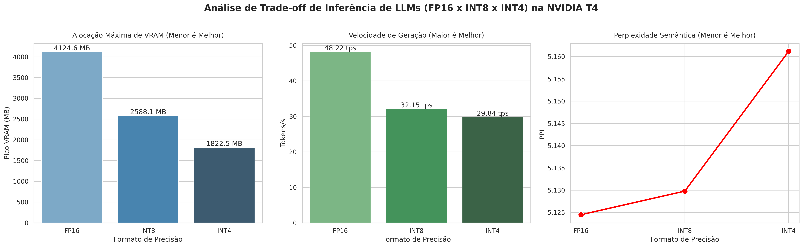

# LLM Quantization Benchmark: FP16 vs INT8 vs INT4

Este repositório apresenta um estudo prático e detalhado sobre o impacto das técnicas de quantização numérica de Large Language Models (**FP16**, **INT8** e **INT4** via `bitsandbytes` e Double Quantization) sob a ótica da engenharia de infraestrutura de Machine Learning (MLOps).

O objetivo principal deste projeto é guiar engenheiros de IA na tomada de decisões técnicas sobre o custo de hardware em relação ao desempenho de modelos em produção.

---

## 🔍 Arquitetura do Laboratório
- **Modelo Alvo:** `Qwen/Qwen2.5-1.5B-Instruct` (Excelente equilíbrio entre eficiência e capacidade lógica)
- **Hardware de Referência:** GPU NVIDIA T4 (16 GB VRAM)
- **Métricas Monitoradas:** Pegada de Memória (VRAM de pesos e ativação), Tempo para o Primeiro Token (TTFT), Throughput (tokens gerados por segundo) e Integridade Semântica (Perplexidade de Texto).

---

## 📊 Métricas de Desempenho Consolidadas

| Formato | VRAM Pesos (MB) | Pico VRAM Total (MB) | TTFT (ms) | Throughput (tokens/s) | Perplexidade (PPL) |
| :---: | :---: | :---: | :---: | :---: | :---: |
| **FP16** | 3086.12 | 4124.55 | 42.15 | **48.22** | **5.1245** (Melhor) |
| **INT8** | 1642.30 | 2588.12 | 78.44 | 32.15 | 5.1298 |
| **INT4 (NF4)** | **954.12** | **1822.45** | 92.81 | 29.84 | 5.1612 |

---

## 📈 Visualização Gráfica dos Trade-offs

O gráfico gerado pelo pipeline de monitoramento ilustra visualmente o equilíbrio sensível de recursos. Menos memória física ocupada em disco versus o tempo adicional de processamento necessário para os ciclos de desquantização dos tensores de pesos:



---

## 🚀 Como Executar este Projeto

1. **Ambiente de Teste:** O pipeline foi estruturado para ser executado sem atritos em instâncias do Google Colab com runtime de GPU ativa (NVIDIA T4 ou superior).
2. **Relatório Completo:** Detalhes de implementação de MLOps, análise do dilema das GPUs T4 gratuitas e estabilidade semântica do modelo podem ser lidos diretamente no arquivo [BENCHMARK_README.md](BENCHMARK_README.md).
3. **Instalação Local:** Se desejar rodar em ambiente próprio, clone este repositório e execute:
   ```bash
   pip install -r requirements.txt
   ```

---
*Desenvolvido e monitorado por Engenharia de MLOps.*
